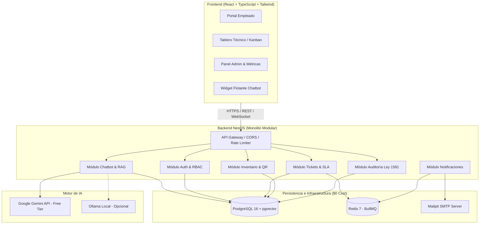
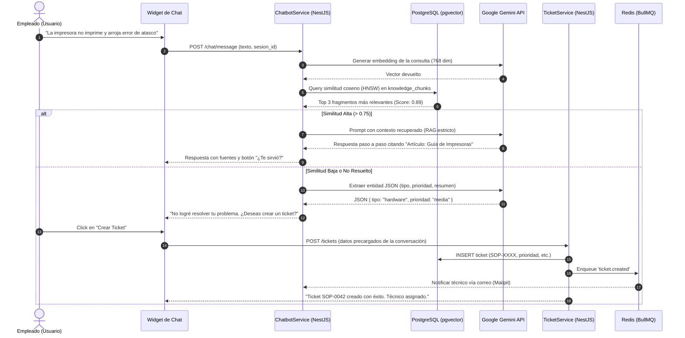

# SoporTI - Documento de Arquitectura de Software

## 1. Visión General del Sistema
**SoporTI** es una plataforma web integral diseñada para la gestión de soporte técnico (mesa de ayuda) y control de inventario de activos tecnológicos (CMDB básica) en pequeñas y medianas empresas (pymes). Integra un asistente conversacional inteligente basado en **Generación Aumentada por Recuperación (RAG)** para resolver incidencias recurrentes de forma autónoma y reducir la carga operativa de los técnicos.

---

## 2. Decisiones de Arquitectura y Patrones

### 2.1. Monolito Modular vs. Microservicios
Se seleccionó un **Monolito Modular** por las siguientes razones técnico-económicas:
* **Costo Operativo Cero ($0):** Permite desplegar la plataforma completa (backend, base de datos, colas y motor de IA) en un único servidor VPS o máquina local sin costo de orquestadores (Kubernetes), mallas de servicios (Istio) ni pasarelas de pago.
* **Consistencia Transaccional (ACID):** Las operaciones críticas (como la asignación de tickets o la escalación desde el chatbot) se ejecutan de manera atómica en una única base de datos relacional.
* **Mantenibilidad y Simplicidad:** Ideal para equipos de desarrollo pequeños o el soporte técnico interno de una pyme.
* **Desacoplamiento Estricto:** Cada módulo (`auth`, `tickets`, `inventory`, `chatbot`, `notifications`) mantiene su propia lógica de negocio y fronteras claras, facilitando una futura extracción a microservicios si la escala lo demandara.

### 2.2. Patrones de Diseño Aplicados
1. **Strategy Pattern:** En la asignación automática de tickets. Permite alternar dinámicamente entre balanceo de carga por especialidad (`SpecialtyAndWorkloadStrategy`) y asignación por turnos (`RoundRobinStrategy`).
2. **Provider / Adapter Pattern:** En el módulo de IA. Desacopla la lógica de RAG del proveedor específico, permitiendo alternar de forma transparente entre **Google Gemini API ($0 Free Tier)** y **Ollama (Local Offline)**.
3. **Repository Pattern:** Para el desacoplamiento de la persistencia de datos mediante TypeORM/Prisma.
4. **Observer / Pub-Sub (Event-Driven):** Emisión de eventos de dominio internos (`TicketCreatedEvent`, `SlaBreachedEvent`) hacia colas de Redis/BullMQ para procesamiento en segundo plano.

---

## 3. Diagramas de Arquitectura (Mermaid)

### 3.1. Arquitectura de Componentes

---

### 3.2. Diagrama de Secuencia: Flujo Chatbot RAG → Escalación a Ticket

---

## 4. Cumplimiento de la Ley 1581 de 2012 (Habeas Data - Colombia)

| Principio Legal | Implementación Técnica en SoporTI |
| :--- | :--- |
| **Principio de Libertad (Consentimiento)** | Tabla `user_data_consents`: se exige aceptación explícita de la política de tratamiento antes de habilitar la cuenta, registrando fecha, hora, IP y versión de la política. |
| **Principio de Finalidad** | Los datos recolectados (correo, teléfono, nombre, área) se limitan exclusivamente a la prestación del servicio de soporte técnico y gestión de activos. |
| **Principio de Seguridad y Confidencialidad** | Contraseñas cifradas con algoritmos de derivación de claves de alta resistencia (Argon2id/Bcrypt). Claves de licencias encriptadas en reposo. |
| **Principio de Acceso y Circulación Restringida** | Control de Acceso Basado en Roles (RBAC): Empleados solo ven sus propios tickets; técnicos ven los tickets asignados y la cola de soporte; administradores tienen acceso global. |
| **Principio de Veracidad y Trazabilidad** | Tabla `audit_logs`: registro inmutable de toda consulta, actualización o eliminación de registros sensibles con usuario, IP y valores anteriores/posteriores. |
